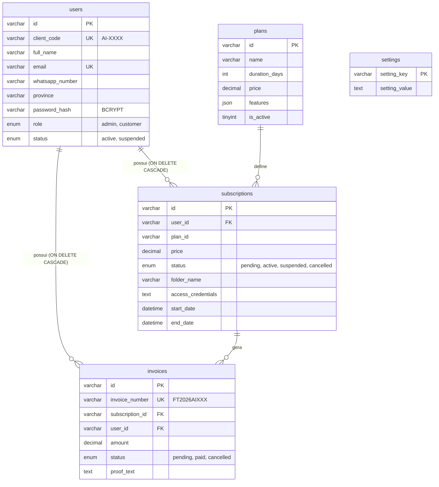

# Plano de Execução e Arquitetura — Subscrições MEGASON (MySQL + cPanel)

> **Status Geral do Projeto:** Arquitetura Migrada e Homologada (Fases 0 a 10 finalizadas)  
> **Sistema / Cliente:** MEGASON  
> **Desenvolvedora & Propriedade do Código:** Zedecks IT  
> **Orçamento:** 8.500 MT (Âmbito estrito)  
> **Domínio de Produção cPanel:** `ai.admin-megason.site` (ou subdomínio cPanel configurado)  
> **Stack Oficial:** HTML5 Semântico, CSS3 Modular (Design Tokens em Light Mode), JavaScript Vanilla (ES Modules), PHP 8.x Nativo com PDO (Prepared Statements), MySQL 8.x / MariaDB 10.4+ (InnoDB com `ON DELETE CASCADE`), Hospedagem cPanel (com compatibilidade local Laragon/XAMPP).

---

## 1. Visão Geral do Produto e Regras de Negócio

Aplicação web completa desenvolvida para a **MEGASON** comercializar e gerir subscrições de contas e acesso ao **ChatGPT Plus**, com conferência de transferências bancárias/carteiras móveis, faturamento oficial canónico e aprovação 100% manual por parte do administrador. Todo o código-fonte pertence à **Zedecks IT**.

### 1.1. Planos Comerciais Fixos e Dinâmicos (Moeda: MZN)
> **Regra de Negócio Central:** Todos os pacotes possuem exatamente os mesmos recursos de inteligência artificial (Modelos GPT avançados, geração e edição de imagens, análise de documentos/PDFs, pesquisa em tempo real, voz e pasta individual com credenciais exclusivas). O que varia é estritamente o valor e a duração em dias, com gatilhos de poupança.

| Plano Oficial | Preço | Duração | Identificador | Benefício / Badge |
| :--- | :---: | :---: | :--- | :--- |
| **Plano 30 Dias** | 300 MT | 30 Dias | `chatgpt-plus-30` | 1 Mês de acesso contínuo |
| **Plano 90 Dias** | 850 MT | 90 Dias | `chatgpt-plus-90` | Destaque • Poupa 50 MT |
| **Plano 180 Dias** | 1.650 MT | 180 Dias | `chatgpt-plus-180` | Poupa 150 MT |
| **Plano 365 Dias** | 3.200 MT | 365 Dias | `chatgpt-plus-365` | Mais Económico (1 Ano) |

*Nota: O Administrador possui total autonomia para criar, editar ou desativar planos diretamente na aba **Pacotes & Preços** do painel administrativo, sendo os dados persistidos na tabela `plans` do MySQL.*

---

### 1.2. Métodos Oficiais de Pagamento Moçambicanos
- **M-Pesa:** `842256366` – Titular: **FRANCISCO**
- **E-Mola:** `861557953` – Titular: **FRANCISCO**
- **Absa Bank:** Conta `0708101028295` | NIB `000207080810102829586` – Titular: **MEGASON**
- **Regra Mandatória de Comprovativo:** O cliente submete o comprovativo exclusivamente em formato de **TEXTO** (copiando e colando a mensagem SMS oficial recebida da operadora ou do banco). O sistema detecta automaticamente se a transferência é M-Pesa, E-Mola ou Absa Bank. Upload de arquivos binários (imagens, PDFs) permanece desativado por questões de segurança e escopo.
- **Configurações Dinâmicas:** Os números e titulares podem ser alterados pelo Administrador na aba de **Configurações**, persistidos na tabela `settings` do MySQL.

---

### 1.3. Regras de Negócio de Subscrições e Vigência

1. **Matemática Estrita de Vigência:**
   - **Nova Ativação ou Subscrição Expirada:** A vigência inicia no momento exato da aprovação pelo administrador e dura `durationDays`.
   - **Renovação Antecipada com Dias Restantes:** Se o cliente já possui dias restantes antes do término (`endDate > NOW()`), o sistema **soma** o novo período contratado ao término anterior, sem qualquer perda de dias pagos pelo cliente.
2. **Numeração Canónica e Atómica de Faturas:**
   - Formato padronizado: `FT[ANO]AIXXX` (exemplo: `FT2026AI001`, `FT2026AI002`...).
   - Numeração gerada de forma atómica e sequencial diretamente no MySQL (`invoices.php`).
3. **Renovação Preventiva Automática (7 Dias):**
   - Quando faltarem 7 dias ou menos para o término de uma subscrição ativa, o sistema emite preventivamente a fatura do ciclo seguinte para permitir o pagamento contínuo sem interrupção de serviço.
4. **Exclusão com Integridade Referencial (`ON DELETE CASCADE`):**
   - A eliminação de um utilizador no painel administrativo aciona nativamente a exclusão em cascata de todas as suas subscrições e faturas no MySQL, garantindo base limpa sem dados órfãos.

---

## 2. Esquema Relacional da Base de Dados MySQL (`database/schema.sql`)

A arquitetura de persistência relacional é composta por 5 tabelas com chaves primárias, índices e constraints de integridade:



---

## 3. Roteiro de Execução e Fases

| Fase | Título | Escopo e Entregas | Status |
| :---: | :--- | :--- | :---: |
| **0** | **Inspecção & Planeamento** | Mapeamento do ambiente, levantamento de regras e definição das restrições de escopo. | **Concluída** |
| **1** | **Requisitos & Domínio** | Definição da modelagem de dados moçambicana, validação telefónica (82-87) e planos. | **Concluída** |
| **2** | **Design System & Light Mode** | Criação dos estilos CSS modulares (`tokens.css`, `base.css`, `layout.css`, `components.css`), sem emojis e sem temas escuros. | **Concluída** |
| **3** | **Landing Page & Vitrine** | Interface de alta conversão, apresentação dos recursos ChatGPT Plus, FAQ e CTA. | **Concluída** |
| **4** | **Autenticação & Perfil** | Registo com as 11 províncias de Moçambique, validação de telemóvel e login seguro. | **Concluída** |
| **5** | **Checkout & Faturamento** | Submissão de comprovativo SMS em texto e geração de faturas `FT[ANO]AIXXX`. | **Concluída** |
| **6** | **Painel Administrativo Executivo** | Sidebar com colapso, KPIs em tempo real, aprovação, suspensão, reativação e cancelamento. | **Concluída** |
| **7** | **Tabelas Atómicas & Ficha de Cliente** | Tabelas sem quebra de texto (`white-space: nowrap`), ficha completa com modal de edição cadastral e atribuição de pacotes. | **Concluída** |
| **8** | **Migração para MySQL + cPanel** | Backend PHP 8.x PDO, schema SQL relacional com `ON DELETE CASCADE`, endpoints REST e suporte a Laragon local. | **Concluída** |
| **9** | **Guia de Deploy & Homologação** | Criação do `CPANEL_DEPLOY_GUIDE.md`, testes locais, scripts `start-local-server` e snapshot `/legacy`. | **Concluída** |
| **10** | **Deploy em Produção cPanel** | Criação da base no phpMyAdmin, upload dos arquivos para `public_html/` e validação final. | **Pronta para Deploy** |

---

## 4. Estrutura de Diretórios da Solução (cPanel Ready)

```text
ai-fj-subscript/
├── admin/
│   └── index.html               # Painel Administrativo com Sidebar colapsável e tabelas atómicas
├── api/
│   ├── config/
│   │   ├── .htaccess            # Bloqueio de segurança para arquivos sensíveis
│   │   ├── cors.php             # Utilitários de CORS, JSON e gerador de IDs/AI-XXXX
│   │   └── db.php               # Conexão PDO (com auto-provisionamento para Laragon e cPanel)
│   ├── auth.php                 # Autenticação, login, registo e perfil (BCRYPT)
│   ├── customers.php            # Gestão de clientes com ON DELETE CASCADE
│   ├── invoices.php             # Faturas sequenciais atómicas FT[ANO]AIXXX
│   ├── plans.php                # CRUD e seed dinâmico de pacotes
│   ├── settings.php             # Coordenadas bancárias e chaves de envio
│   └── subscriptions.php        # Gestão de pedidos, cálculo de vigência e métricas
├── css/
│   ├── base.css
│   ├── components.css           # Estilos das tabelas sem wrap, sidebar e modais
│   ├── layout.css
│   └── tokens.css               # Design tokens em Light Mode estrito
├── database/
│   └── schema.sql               # Script DDL completo com índices, CASCADE e seed oficial
├── docs/
│   └── PLANO.md                 # Este documento de referência arquitetural
├── js/
│   ├── admin.js                 # Controlador da Área Administrativa
│   ├── app.js                   # Controlador da Landing Page e Checkout do Cliente
│   └── services/
│       ├── api.js               # Cliente REST com fallback inteligente
│       ├── auth.js              # Serviço de autenticação integrado à API PHP/MySQL
│       ├── email.js             # Serviço de notificações e templates WhatsApp
│       ├── plans.js             # Gestão de planos comerciais
│       └── subscriptions.js     # Gestão de subscrições, vigência e faturas
├── legacy/                      # Arquivo histórico da versão anterior Firebase
│   ├── firestore.rules
│   ├── README.md
│   └── js/
├── .env.example                 # Modelo de variáveis de ambiente (Laragon vs cPanel)
├── .gitignore                   # Proteção de credenciais locais
├── CPANEL_DEPLOY_GUIDE.md       # Manual detalhado de instalação no cPanel
├── favicon.svg                  # Ícone profissional da plataforma
├── index.html                   # Página principal voltada ao cliente
├── start-local-server.bat       # Inicializador local para Windows / Laragon (Porta 1080)
└── start-local-server.sh        # Inicializador local para Linux / Bash (Porta 1080)
```

---

## 5. Critérios de Aceitação e Boas Práticas

1. **Zero Frameworks Pesados:** Apenas JavaScript Vanilla nativo com ES Modules modernos, garantindo carregamento instantâneo em conexões móveis de Moçambique.
2. **Segurança Ofensiva e Defensiva:**
   - Consultas 100% parametrizadas via `PDO::prepare()`, eliminando vetores de SQL Injection.
   - Senhas criptografadas com `password_hash(PASSWORD_BCRYPT)`.
   - Proteção de diretórios via `.htaccess` negando acesso público a scripts de credenciais.
3. **Design & Usabilidade:**
   - **Light Mode Estrito:** Interface limpa no estilo oficial da OpenAI/ChatGPT.
   - **Zero Emojis na Interface:** Uso exclusivo de ícones SVG semânticos.
   - **Tabelas Atómicas e Ricas:** 13 e 12 colunas sem quebra de linha (`white-space: nowrap`), mantendo a legibilidade de dados densos.
   - **Rodapé Padronizado:** © no canto esquerdo e `Dev. By Zedeck's IT. | v1.0.0` no canto direito.
4. **Política de Portas Localhost:** Uso estrito da faixa permitida para projetos de clientes (**Porta 1080** dentro da faixa 1000 - 1999).
